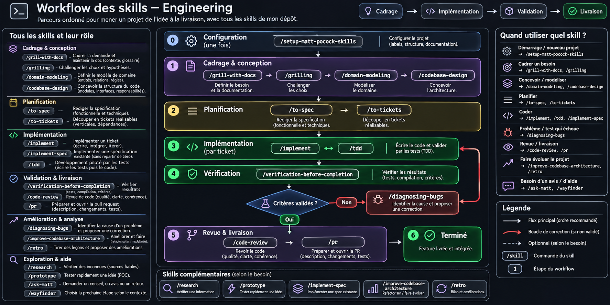

# skills



Agent skills, installable with the [skills CLI](https://github.com/vercel-labs/skills):

```
npx skills add Zolkyed/skills
```

## Skills

**Mode:**

- `manual`: only runs when you type it
- `auto`: the model can also trigger it

| Skill | Mode | What it does |
|---|---|---|
| `setup-matt-pocock-skills` | manual | Configure a repo once: issue tracker, triage labels, domain doc layout. |
| `grill-with-docs` | manual | Grilling session that also builds the domain model (`GLOSSARY.md`, ADRs). |
| `grilling` | auto | Interview you until every branch of a plan or decision is settled. |
| `domain-modeling` | auto | Sharpen terms and the domain model, update `GLOSSARY.md` and ADRs. |
| `codebase-design` | auto | Vocabulary for deep modules: small interfaces, clean seams. |
| `to-spec` | manual | Turn the conversation into a spec on the issue tracker. |
| `to-tickets` | manual | Split a spec into tracer-bullet tickets with blocking edges. |
| `implement` | manual | Build a spec or tickets with `/tdd`, then `/code-review`. |
| `implement-spec` | manual | Whole spec on one integration branch, parallel subagents. |
| `tdd` | auto | Red-green-refactor, one vertical slice at a time. |
| `verification-before-completion` | auto | No "done" or "passing" claim without fresh verification output. |
| `diagnosing-bugs` | auto | Feedback loop that goes red on the bug, then fix and regression test. |
| `code-review` | auto | Two-axis review of a diff: Standards and Spec. |
| `pr` | auto | Shape of a PR body: visual summary, evidence, one-way or two-way door. |
| `triage` | manual | Move incoming issues through triage roles, write agent briefs. |
| `improve-codebase-architecture` | manual | Find deepening opportunities, report, then grill the one you pick. |
| `retro` | manual | Suggest improvements to the agent's environment after a session. |
| `research` | auto | Investigate a question with primary sources, write a cited Markdown file. |
| `prototype` | auto | Throwaway prototype (HTML logic demo or UI variants) on a throwaway branch. |
| `wayfinder` | manual | Map a huge effort as decision tickets, resolve them one by one. |
| `wizard` | auto | Interactive bash wizard for steps only a human can perform. |
| `ask-matt` | manual | Router: which skill or flow fits your situation. |

## References

- [mattpocock/skills](https://github.com/mattpocock/skills): the engineering skills (MIT, see `LICENSE`)
- [obra/superpowers](https://github.com/obra/superpowers): `verification-before-completion` (MIT, Copyright (c) 2025 Jesse Vincent, license included in that skill's folder)
